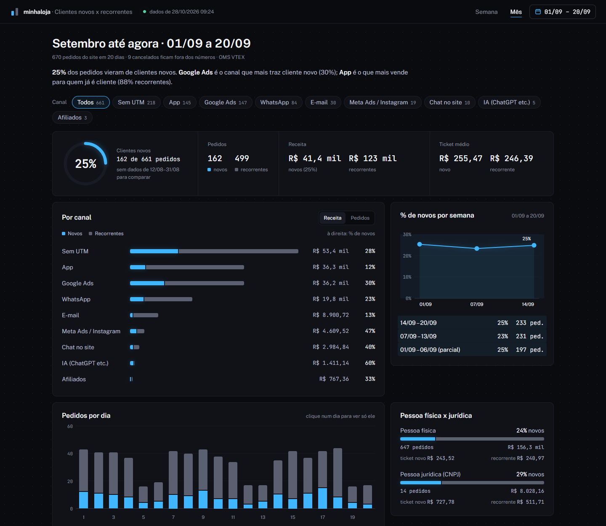
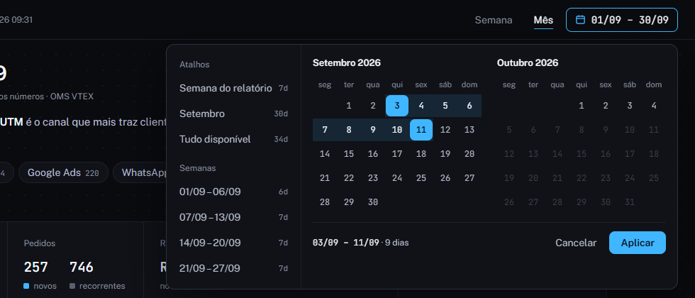
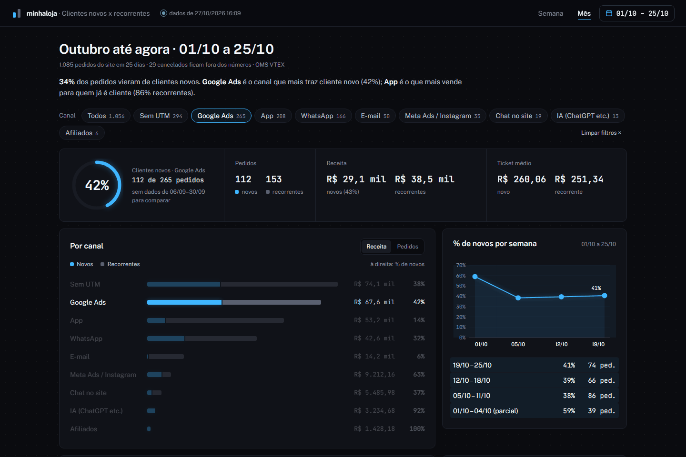
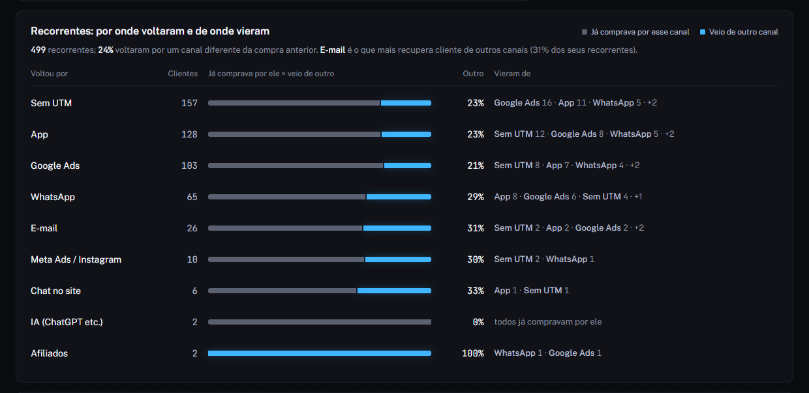

# vtex-clientes-novos

**Quantos dos seus pedidos da semana vieram de clientes novos, e por qual canal?**



O export de pedidos do Admin da VTEX não diz se o cliente já comprou antes, e também não traz o
e-mail nem o CPF para você descobrir na planilha. Por isso fica difícil responder perguntas como:

- O Google Ads está trazendo cliente novo ou só recomprando quem já é da casa?
- Quanto do faturamento do WhatsApp vem de clientes novos?
- Quem comprou pelo app voltou pelo app ou por outro canal?

Este projeto responde isso **toda segunda-feira, sozinho**, usando o GitHub Actions. Não precisa de
servidor, banco de dados nem instalação na loja.

## O que você recebe

**Um painel interativo** (um arquivo HTML que abre no navegador, sem instalar nada), com:

- % de clientes novos, receita e ticket médio de novos x recorrentes;
- a divisão **por canal** (Google Ads, WhatsApp, Meta Ads, E-mail, App…), montada a partir das UTMs;
- **calendário** para ver qualquer intervalo de dias do mês, e atalhos para a semana e o mês;
- pedidos por dia, % de novos por semana e a comparação com os dias anteriores;
- para os recorrentes, **por qual canal voltaram e de qual canal vieram**;
- pessoa física x jurídica e o detalhe por UTM, com busca;
- filtro cruzado: clique num canal ou num dia e o painel inteiro se ajusta.

Veja um exemplo com dados fictícios: baixe [docs/exemplo-painel.html](docs/exemplo-painel.html) e abra no navegador.

**Escolha os dias no calendário**, ou use os atalhos da semana e do mês:



**Clique num canal e o painel inteiro se ajusta.** Aqui, só o Google Ads: 30% de clientes novos,
ticket médio e evolução semanal do canal.



**Recorrentes: por qual canal voltaram e de qual vieram.** Mostra, por exemplo, quanto do WhatsApp é
cliente que comprou antes pelo Google Ads.



*Todas as imagens usam uma loja fictícia.*

**Um comentário numa issue** do seu repositório (o GitHub manda por e-mail) com o resumo da semana e
do **mês até agora**: totais, divisão por canal, recorrentes por canal anterior e detalhe por UTM.

E **duas planilhas** (CSV que abre direto no Excel), uma da semana e outra do mês, com um pedido por linha:

`pedido; data; status; valor; tipo_cliente; canal; ultima_compra_anterior; canal_compra_anterior; pessoa; utm_source; utm_medium; utm_campaign; cupom`

A planilha **não traz nome, e-mail nem CPF**. Para juntar com o export do Admin, cruze pela coluna `pedido`.

Exemplos com dados fictícios: [docs/exemplo-relatorio.md](docs/exemplo-relatorio.md) e
[docs/exemplo-planilha.csv](docs/exemplo-planilha.csv).

O painel e as planilhas ficam no **artefato** de cada execução: no comentário da issue, clique no
link da execução, desça até **Artifacts** e baixe **clientes-novos** (um `.zip`). Extraia e abra
`clientes-novos-painel.html`. O GitHub guarda o artefato por 90 dias.

## Como funciona

1. Lê na VTEX (API de pedidos, só leitura) os pedidos do dia 1º do mês até o domingo da semana
   anterior, no canal de venda escolhido. A semana (segunda a domingo) e o mês são recortes dessa
   lista; na semana que vira o mês, o mês anterior sai fechado. Entram todos os status; os cancelados aparecem, mas ficam fora da receita.
2. Para cada pedido, procura o mesmo cliente (CPF/CNPJ, ou e-mail se não houver documento) em pedidos
   anteriores **não cancelados**. Encontrou: **recorrente**. Não encontrou: **novo**.
3. Classifica o canal pelas UTMs, com as regras do [`canais.json`](canais.json).

> **Limite da VTEX:** a API só devolve pedidos dos **últimos 2 anos**. Então "novo" quer dizer "sem
> compra nos últimos 24 meses": quem comprou há 3 anos e voltou conta como novo.

Outros casos em que um cliente antigo pode aparecer como novo:

- comprou antes **só com e-mail** (sem CPF/CNPJ no pedido) e agora comprou com documento, ou o
  contrário: a chave de busca muda e as compras não se encontram;
- a busca da VTEX devolveu outros pedidos antes dos dele: o script confere os 3 primeiros resultados.

## Como usar (15 minutos)

### 1. Crie o seu repositório a partir deste template

Clique em **Use this template → Create a new repository** e escolha **Private**.

> ⚠️ **O repositório precisa ser privado.** O relatório mostra o faturamento da sua loja. Se o
> repositório for público, a automação para com um aviso em vez de publicar.

### 2. Crie uma chave de API na VTEX, só com leitura de pedidos

No Admin da VTEX:

1. **Configurações da conta → Perfis de acesso → Novo perfil**. Dê um nome (ex.: `Leitura de pedidos`)
   e adicione só os recursos **View order** e **List Orders** (produto **OMS**). Salve.
2. **Configurações da conta → Chaves de aplicação → Gerenciar minhas chaves → Gerar nova chave**.
   Associe ao perfil criado no passo anterior.
3. Copie a **appKey** e o **appToken**. O token só aparece uma vez.

### 3. Cadastre a chave e a conta no GitHub

No seu repositório: **Settings → Secrets and variables → Actions**.

| Tipo | Nome | Valor |
|---|---|---|
| Secret | `VTEX_APP_KEY` | a appKey |
| Secret | `VTEX_APP_TOKEN` | o appToken |
| Variable | `VTEX_ACCOUNT` | o nome da conta (o `minhaloja` de `minhaloja.myvtex.com`) |

Opcionais (aba **Variables**):

| Nome | Padrão | Para que serve |
|---|---|---|
| `CANAL_DE_VENDA` | `1` | canal de venda (sales channel) analisado |
| `DIAS_DE_HISTORICO` | `730` | quantos dias para trás contam como "já comprou" (máximo 730) |
| `RESPONSAVEL` | – | usuário do GitHub que fica como responsável pela issue |

### 4. Rode a primeira vez

> Em repositório criado a partir do template, o GitHub deixa o Actions desligado e mostra
> "Workflows aren't being run on this repository". Abra a aba **Actions** e clique em
> **Enable Actions** (ou "I understand my workflows, go ahead and enable them"). Sem isso, nem a
> execução manual nem a de segunda rodam.

**Actions → Clientes novos x recorrentes → Run workflow.** Em poucos minutos aparece a issue
"Clientes novos x recorrentes" com o resumo da semana anterior. A partir daí, roda sozinho toda
segunda às 08h15 (horário de Brasília).

Para refazer uma semana específica, preencha `week_start` com a segunda-feira dela (`AAAA-MM-DD`).
Desmarque `publicar` para rodar sem comentar na issue (o painel e as planilhas saem no artefato do
mesmo jeito).

## Ajustando os canais

Cada loja nomeia as UTMs do seu jeito. Edite o [`canais.json`](canais.json): cada canal tem um nome
e uma expressão regular, que é testada contra `utm_source utm_medium utm_campaign`. **Vale a primeira
regra que casar**, então coloque as mais específicas primeiro. Por exemplo, o chat do site vem antes
do WhatsApp quando os dois usam UTMs do mesmo fornecedor.

Pedidos sem UTM ficam em **Sem UTM**. UTMs que não casam com nenhuma regra ficam em **Outros** e são
listadas no fim do resumo, para você saber o que acrescentar.

Também é assim que você junta UTMs antigas e novas do mesmo canal. Se você trocou de ferramenta de
WhatsApp, coloque as UTMs das duas na mesma regra.

## Privacidade (LGPD)

- A chave da VTEX só precisa de **leitura** de pedidos.
- CPF, CNPJ e e-mail são usados **só em memória**, para achar compras anteriores, e não aparecem em
  nenhum arquivo, log, issue, planilha ou painel. Mensagens de erro da VTEX vão para o log sem a
  busca e com documentos e e-mails mascarados.
- O painel é um arquivo dentro do artefato privado do repositório; não é publicado em nenhum site.
- A automação roda dentro do **seu** repositório privado, na **sua** conta do GitHub. Os dados dos
  pedidos não saem para terceiros. Ao abrir o painel, o navegador baixa só as fontes do Google Fonts.

## Custo e tempo

O tempo cresce com o número de pedidos, porque cada pedido é aberto e o histórico do cliente é
consultado. Uma loja com algumas centenas de pedidos por semana leva poucos minutos no começo do mês
e até ~15 minutos no fim (o mês inteiro é relido). Repositório privado no plano gratuito do GitHub
tem 2.000 minutos de Actions por mês, e esta automação usa algumas dezenas. Quando a VTEX limita as
consultas (erro 429), o script espera e tenta de novo.

## Rodando no seu computador

Precisa do Node 20 ou mais novo.

```bash
VTEX_ACCOUNT=minhaloja VTEX_APP_KEY=... VTEX_APP_TOKEN=... npm start
npm test   # testes com uma VTEX simulada, sem rede
```

As planilhas, o resumo e o painel (`clientes-novos-painel.html`) saem na pasta em que você rodou.

## Contribuindo

Ideias, regras de canal novas e correções são bem-vindas: abra uma issue ou um pull request. Os
testes (`npm test`) rodam sozinhos em cada PR.

## Licença

[MIT](LICENSE)
